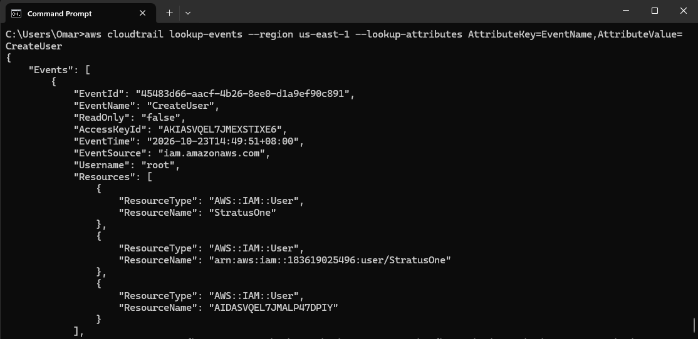
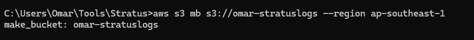

## CloudTrail Configuration

We can monitor and evaluate telemetry using AWS Cloudtrail. After setting up the attack vector, we may now configure Cloudtrail.

A test sample to check in for user creation:

However, we will want to configure a proper pipline for our logs for a more mature environment by using specific trails from AWS Cloudtrail, and routing them into an S3 Bucket, and eventually into a SIEM, which would help for a more automated pipeline rather than constantly running `Event-lookup` command for active monitoriing.

## Step One: Creating Trail

Setting up here a basic trail that routes into a an S3 bucket using the command `create trail`. Additionally this trail is going to be for Management Events.

## Step Two: Setting up S3 Bucket

We can set up an AWS S3 Bucket to store the incoming logs from cloudtrail and use this later for log analysis and relating each telemetry to understand what kind of attack has been launched against the Cloud Environment. 

