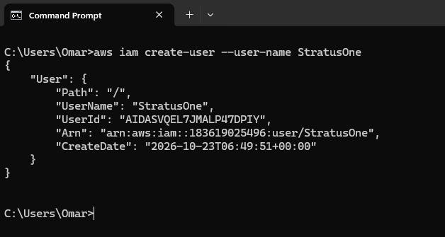
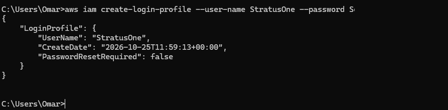
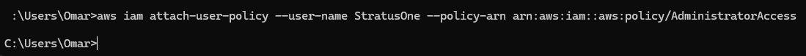
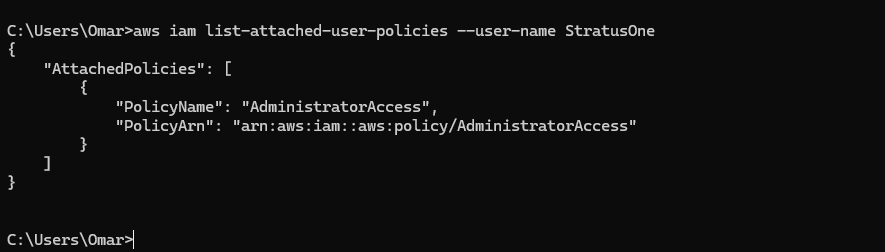
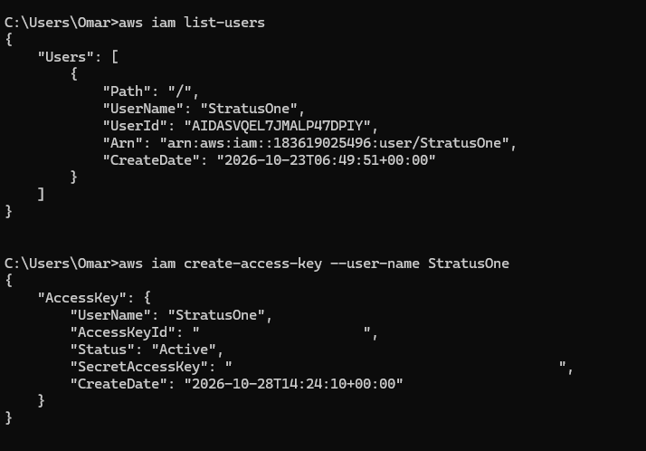
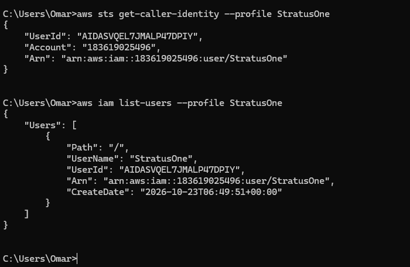

## Stratus Red Team

Stratus Red Team is security tool made by DataDog that help simulate attacks on cloud environment which fits well with this setup.

It is important to create a role for the tool using IAM (Identity and Access Management) service in AWS in order for it to be configured and used in the cloud environment. 

## Step One: Creating the IAM Role

Using the Root User to create the user and role for Stratus Red Team. This was done using the CLI from my local machine that is connected to the Root User. 

## Step Two: Attaching Policies

In order to simulate an attack vector from Stratus Red Team user, we would need to allow administrator privileges and policies. This is done using the **aws iam attach-user-policy** command and then verifying through **list-attached-policies** command

## Verification

## Step Three: Creating Key and Logging into the Terminal

Using command `aws iam create-access-key` to create an access key to access the user from the local terminal, and testing profile configuration with `aws sts get-caller-identity --profile StratusOne` and following through with a `aws iam list-users --profile StratusOne` to test privileges or previously given **Administrator access**.

