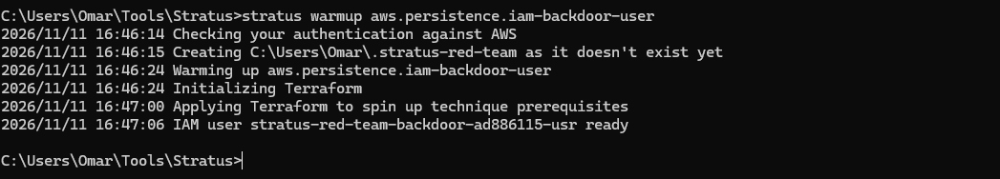
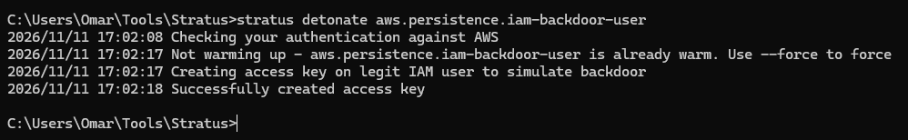
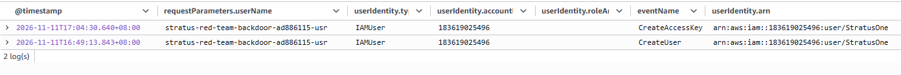
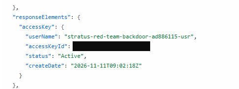

## Attack Vector 1: IAM-Backdoor-User (Persistence Technique)

Using Stratus's IAM Backdoor user, is a persistence technique whereby it establishes persistence by creating an access key on an existing IAM user.

**Objective:* Detect an access key being created for an existing IAM user.

Simulation: aws.persistence.iam-backdoor-user. Stratus Red Team warmup creates the target user and detonation creates its access key.



**Detonation**



Using the following Query within AWS Cloudwatch: 

```sql
SOURCE logGroups(namePrefix: [], class: "STANDARD") START=-1h END=0s |
fields @timestamp, requestParameters.userName, userIdentity.type, userIdentity.accountId, userIdentity.roleArn, eventName, userIdentity.arn
| filter eventName in ["CreateUser", "AttachUserPolicy", "CreateAccessKey"]
| sort @timestamp desc
| limit 10000`
```

Identifying the CreateAccessKey event, the caller (userIdentity.arn), the target (requestParameters.userName), and whether it succeeded.

## Resulting Log Output



The CloudTrail event shows StratusOne successfully creating an access key for the target IAM user. This demonstrates persistence through additional credentials without requiring a new policy attachment during detonation.  Proof of successful access key creation below also demonstrated from ResponseElements within the log.



Detection Limit: Creating access keys can be legitimate. The filter finds events worth investigating; it doesn’t automatically prove malicious activity. The warmup prepared the user, and detonation created its access key. The `CreateAccessKey` log demonstrates the credential creation. It doesn’t, by itself, prove that the new key was subsequently used or that the target user had administrator access.

